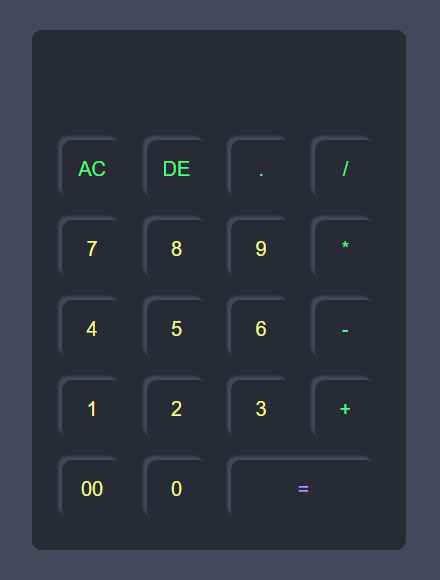

# Dracula Calculator

A simple calculator in HTML, CSS and JavaScript, using the [Dracula](https://draculatheme.com/) color palette.



## Features

- Addition, subtraction, multiplication and division, with operator precedence.
- Expressions are evaluated by a small parser in `script.js`, without `eval()`.
- Keyboard support: numbers and operators, `Enter` to calculate, `Backspace` to delete and `Esc` to clear.

## How to use

Clone the repository and open `index.html` in your browser. No build step or dependencies.

```bash
git clone https://github.com/JohnnyRei/Dracula-Calculator.git
```

## License

[MIT](LICENSE)
